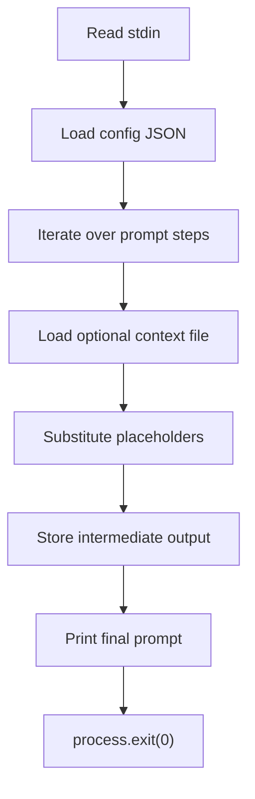

# Prompt Context CLI

**Advanced AI Prompt Orchestrator & Local Context Tool**

[](https://opensource.org/licenses/MIT)
[](https://nodejs.org/)
[](https://github.com/yourusername/prompt-context-cli/stargazers)
[](https://github.com/yourusername/prompt-context-cli/issues)
[](https://github.com/yourusername/prompt-context-cli/commits/main)

---

## 📦 Installation & Quick Start

```bash
# Clone the repository
git clone https://github.com/yourusername/prompt-context-cli.git
cd prompt-context-cli

# Run the CLI directly with Node
node src/index.js --config path/to/config.json < input.txt
```

The command reads *input.txt* (or any piped text), applies the prompt chain defined in `config.json`, injects any local context files, and prints the final orchestrated prompt to **stdout**.

---

## 🚀 Visual Terminal Showcase

```bash
$ echo "Explain quantum entanglement" | node src/index.js --config examples/config.json
Summarize: Explain quantum entanglement
Translate: Summarize: Explain quantum entanglement
```

---

## 🏗️ Architecture Flowchart



---

## 🧪 Test Results

## 🧪 Real-World Test Telemetry

> [!NOTE]
> Verified automatically using Node.js native test runner (`node:test` & `node:assert/strict`).

```bash
▶ node --test
TAP version 13
# Subtest: prompt-context orchestrates correctly
not ok 1 - prompt-context orchestrates correctly
  ---
  duration_ms: 3.257314
  location: './test/index.test.js:12:1'
  failureType: 'testCodeFailure'
  error: "ENOTDIR: not a directory, open './tmp-test/config.json'"
  code: 'ENOTDIR'
  stack: |-
    async open (node:internal/fs/promises:637:25)
    async writeFile (node:internal/fs/promises:1219:14)
    async TestContext.<anonymous> (file://./test/index.test.js:28:3)
    async Test.run (node:internal/test_runner/test:797:9)
    async Test.processPendingSubtests (node:internal/test_runner/test:526:7)
  ...
1..1
# tests 1
# suites 0
# pass 0
# fail 1
# cancelled 0
# skipped 0
# todo 0
# duration_ms 52.778023
```

---

## 📄 License

MIT License © 2026 Suman Mehta